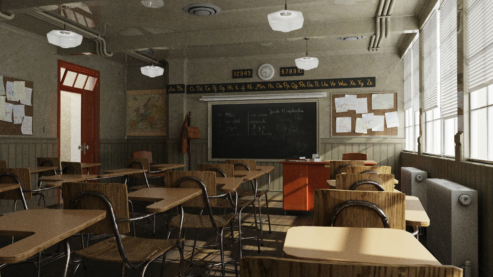
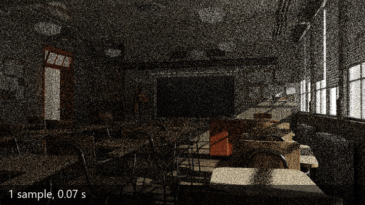
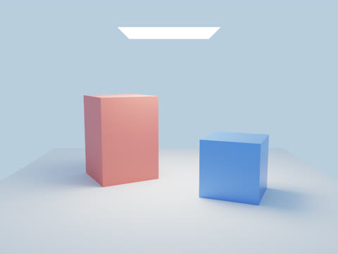
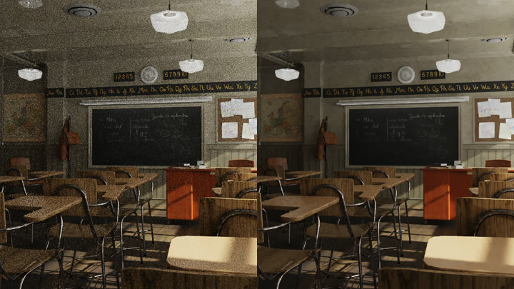

<p align="center">
  <a href="https://crucible.codepawl.com">
    <picture>
      <source media="(prefers-color-scheme: dark)" srcset="https://crucible.codepawl.com/brand/crucible-lockup-dark.png">
      
    </picture>
  </a>
</p>

<h1 align="center">Cook</h1>



<sub>Classroom by Christophe Seux (CC0, Blender demo files), rendered by Cook at 1280x720 and 512 samples in about 27 seconds on an NVIDIA A10G.</sub>

Cook is a path tracer for the GPU. It traces a scene with hardware ray queries (Vulkan, through wgpu) and returns linear float images, plus the albedo, normal, depth and variance of the first hit. Its `cycles` kernel follows the light transport of Blender Cycles: the Principled BSDF, the light tree, Sobol-Burley sampling, the Cycles pixel filters. Measurements against Cycles are in the [Crucible parity notes](https://github.com/codepawl/crucible/blob/main/docs/cycles-parity.md).

A scene reaches Cook as packed binary tables, the "FORMAT-v2" input ([FORMAT-v2.md](./FORMAT-v2.md)). The packers in this package build those tables, a `.cookpack` file stores them, and the command line renders such a file without any other code.



<sub>Each sample adds one light path per pixel, so the noise fades as the samples add up. Sampling times on an NVIDIA A10G at 1280x720.</sub>

## Where it runs

| Machine | Render with the GPU | Pack and read scenes |
| :--- | :---: | :---: |
| Windows 10 or 11, x64 | yes | yes |
| Linux, x64 (desktop or cloud GPU) | yes | yes |
| macOS | no | yes |
| Browser page | no | yes |

To render, the GPU must support Vulkan ray queries (`VK_KHR_ray_query`). NVIDIA RTX, AMD Radeon RX 6000 and Intel Arc cards and newer report it. Cook was measured on NVIDIA cards only: RTX 3060, RTX 4090 and A10G. The DX12 and Metal backends do not give Cook ray queries, so it uses Vulkan only.

Packing and reading scenes is JavaScript only. The packers and `pack-file.mjs` import nothing from Node, so a browser page can run them.

## Install

You need Node 20.19 or newer and the driver of your GPU. On Windows x64 and Linux x64 you do not need Rust: Cook downloads a prebuilt addon.

1. If you use Linux, install the Vulkan loader and the libraries that the NVIDIA Vulkan driver loads. On Debian or Ubuntu:

   ```sh
   sudo apt install libvulkan1 libegl1 libgl1 libx11-6 libxext6
   ```

   A desktop system usually has the last four already. A server or a container needs them. In Docker, also set `NVIDIA_DRIVER_CAPABILITIES=all`, so that the container gets the graphics part of the driver.

2. Install a released version of Cook:

   ```sh
   npm install github:codepawl/cook#v0.1.1
   ```

   If npm says `Fetching packages of type "git" have been disabled`, add `--allow-git=all` to the command. npm 12 needs it for a package from GitHub.

3. Download the prebuilt addon. It prints `Downloaded the prebuilt addon to` and the path.

   ```sh
   npx cook fetch-addon
   ```

4. Render the test room. It writes `room.png`.

   ```sh
   npx cook render node_modules/@codepawlhq/cook/fixtures/room.cookpack --output room.png --width 800 --samples 256
   ```

   

   The room renders at 800x600 and 256 samples in about 1 second on an A10G. The first render in a new process also compiles the shaders, which adds 10 to 15 seconds.

`cook fetch-addon` takes the addon of the installed version from its GitHub release and checks its SHA-256 before it writes `build/render-native.node`. The Linux addon is built on Ubuntu 22.04, so it needs that glibc or a newer one. If the GPU is from AMD or Intel, Linux also needs its Vulkan driver: `sudo apt install mesa-vulkan-drivers`.

### Build from source

Build the addon yourself on another system, for a commit that is not a release, or when you change Cook. You need Rust (stable) too, and the build takes a few minutes.

On Windows:

1. Install Node, Rust and the C++ build tools:

   ```powershell
   winget install OpenJS.NodeJS.LTS Rustlang.Rustup
   winget install Microsoft.VisualStudio.2022.BuildTools --override "--add Microsoft.VisualStudio.Workload.VCTools --includeRecommended --passive"
   ```

2. Open a new terminal, so that `node` and `cargo` are on the `PATH`.
3. Add the MSVC target. The GNU toolchain crashes every wgpu 30 program.

   ```powershell
   rustup target add x86_64-pc-windows-msvc
   ```

On Linux:

1. Install Rust:

   ```sh
   curl --proto '=https' --tlsv1.2 -sSf https://sh.rustup.rs | sh
   ```

2. Install the Vulkan loader and a C compiler: `sudo apt install libvulkan1 build-essential`.

Then, on both systems:

1. Install Cook. Leave out `#v0.1.1` to get the newest commit.

   ```sh
   npm install github:codepawl/cook
   ```

2. Build the addon. It prints `Built build/render-native.node`.

   ```sh
   npm --prefix node_modules/@codepawlhq/cook run build
   ```

Installing runs no script. Building takes the Rust crates listed in `Cargo.lock` from crates.io. From a clone of this repository, run `npm run build` in the clone. `COOK_ADDON_PATH` names an addon built somewhere else. If that path does not exist, Cook stops with an error.

### If the install or the render fails

| Message | Cause and fix |
| :--- | :--- |
| `No Vulkan adapter` | The Vulkan loader or the GPU driver is missing. Install the driver of your GPU and, on Linux, `libvulkan1`. |
| `The Vulkan adapter does not support ray queries` | The message names the adapter. If it says "software adapter", the GPU driver did not load: install the libraries of step 1, and see the cloud note below. Otherwise the GPU is too old. |
| `Refusing to fetch "github:codepawl/cook..."` | npm 12 blocks packages from GitHub. Add `--allow-git=all` to `npm install`. |
| Exit code 5 | The addon is missing, does not load or did not download. Run `npx cook fetch-addon` again, or build from source. |

On a rented Linux GPU box, the host sometimes gives the container only the compute libraries of the NVIDIA driver. Then `vulkaninfo --summary` lists only `llvmpipe`. Copy the graphics libraries of the same driver version (`libEGL_nvidia`, `libGLX_nvidia`, `libnvidia-glcore`, `libnvidia-eglcore`, `libnvidia-glsi`, `libnvidia-tls`, `libnvidia-glvkspirv`, `libnvidia-rtcore`, `libnvidia-gpucomp`) into `/usr/lib/x86_64-linux-gnu`, and point `/etc/vulkan/icd.d/nvidia_icd.json` at `libEGL_nvidia.so.0`. Then `vulkaninfo | grep VK_KHR_ray_query` finds the extension.

## Use Cook from an app

| App | How |
| :--- | :--- |
| Terminal | `npx cook render <scene.cookpack> --output <file.png>`, see [Command line](#command-line). |
| Node.js | `import { traceNative } from '@codepawlhq/cook'`, see [JavaScript](#javascript). |
| [Crucible](https://github.com/codepawl/crucible) | Crucible builds its scenes with the packers of this package and renders them with Cook. It pins one commit of this repository. |
| Blender 4.2 or newer | The add-on in Crucible adds Cook to the Render Engine list. Setup: [docs/blender-addon.md](https://github.com/codepawl/crucible/blob/main/docs/blender-addon.md) in the Crucible repository. |
| Browser page | Import `@codepawlhq/cook/pack-input-v2` and `@codepawlhq/cook/pack-file` to build and save `.cookpack` files. Render them on a machine with the addon. |

## Command line

```sh
node bin/cook.mjs info fixtures/room.cookpack
node bin/cook.mjs render fixtures/room.cookpack --output room.png
node bin/cook.mjs render fixtures/room.cookpack --output room.npy --samples 256 --denoise atrous
```

`fixtures/room.cookpack` is a small room (a floor, two boxes, an emissive panel and a sky colour) made by `tools/make-fixture-pack.mjs` without any other code (that script is in the repository only; the npm package ships the fixture, not the script). After install the command is `npx cook ...`. `cook fetch-addon` downloads the prebuilt addon, see [Install](#install).

- `cook render <scene.cookpack> --output <file.png|file.npy>` renders with the `cycles` kernel. A `.png` is 8 bit with the ACES curve and gamma 2.2 that Crucible uses by default; a `.npy` is the linear float32 RGBA image, shape height x width x 4.
- `--width`, `--height` change the size at the aspect ratio of the pack (the camera in the pack is fixed to it); `--samples`, `--max-seconds` (stops with exit code 4 and writes nothing), `--denoise none|atrous` and `--dispatch-samples` are the other options. Seed, camera and bounce limits are stored in the pack.
- `--denoise atrous` smooths a render with few samples. It is fast and blurs fine detail. The picture shows the Classroom at 64 samples, before the filter on the left and after it on the right.

  

- `cook info <scene.cookpack>` prints the container version, pack revision, image size, record counts and the table directory.
- `cook --help` lists the options and the exit codes (0 done, 1 render failed, 2 wrong arguments, 3 unreadable, damaged, too new or too old pack, 4 time limit, 5 addon not built or not loadable).

## JavaScript

```js
import { readFileSync } from 'node:fs';
import { describeEngine, findNativeAddon, traceNative } from '@codepawlhq/cook';
import { decodePackFile } from '@codepawlhq/cook/pack-file';

if (findNativeAddon() === null) throw new Error('Build the addon first: npm run build');
const input = decodePackFile(readFileSync('fixtures/room.cookpack'));
const { rgba, adapter, tracedSeconds } = traceNative(input, { kernel: 'cycles', width: 160, height: 120, samples: 64 });
console.log(describeEngine().packFormat, adapter, tracedSeconds); // rgba: linear float RGBA, rows from the top
```

`describeEngine()` (also `@codepawlhq/cook/engine`) reports the version, the pack format and revision it reads, the kernels, result passes and limits, and does not load the addon. A trace that passes `maxSeconds` throws an error with `code: 'COOK_TIME_LIMIT'` (`isTimeLimitError(error)`). `COOK_KERNEL` sets the default kernel (`JS67_NATIVE_KERNEL` is still read after it).

`readAdapterCapacity()` reads what the card can hold before you export a scene: `deviceLocalMemoryBytes` (left out, with the reason in `deviceLocalMemorySource`, when the driver reports no device-local heap), `largestTableBytes` (the most one table of the scene may take), the bytes one unique triangle (`triangleTableBytes` + `triangleVertexBytes`), instance (`instanceTableBytes`) and texture texel (`texelBytes`) cost, and the counts those allow (`maxUniqueTriangles`, `maxInstances`, `maxTextureTexels`). The costs count the packed tables only; the acceleration structure is sized by the driver and is not in them. A scene over a limit fails in `traceNative` with one error that names the table, its size, the limit and the overshoot, and says what to drop.

## Pack files

A `.cookpack` file holds the tables of one FORMAT-v2 input in a little-endian container: a header, a directory of named tables, a JSON metadata block (counts, pack revision) and the tables, 8-byte aligned. `encodePackFile(input)` and `decodePackFile(bytes)` in `@codepawlhq/cook/pack-file` write and read it with no Node imports; every read is bounds checked and a damaged file is refused with an error that says what is wrong. The layout is section 10 of [FORMAT-v2.md](./FORMAT-v2.md). Treat pack files from others as untrusted input ([SECURITY.md](./SECURITY.md)).

The input itself comes from `buildNativeInputV2(scene, camera, options)` (`@codepawlhq/cook/pack-input-v2`), which takes either a Crucible trace scene or an explicit `{ instances, materials }` descriptor, as `tools/make-fixture-pack.mjs` does. `PACK_REVISION` counts the changes that make an older input render differently; a pack file of a revision the engine does not read is refused.

## Licence

Cook is MIT licensed ([LICENSE](./LICENSE)). The `cycles` kernel files adapt code from Blender Cycles and Open Shading Language and carry Apache-2.0 and BSD-3-Clause headers; the licence expression of the package is `MIT AND Apache-2.0 AND BSD-3-Clause`. The files, copyright holders and licence texts are in [THIRD-PARTY-NOTICES.md](./THIRD-PARTY-NOTICES.md) and [LICENSE-APACHE](./LICENSE-APACHE). [CONTRIBUTING.md](./CONTRIBUTING.md) says how to build and test.

## Reference

The sections below are the technical notes of the packages and kernel; they were written inside Crucible, so some examples name its scene builders and files, linked by URL.

```js
import { buildNativeInput, traceNative } from '@codepawlhq/cook';
import * as pack from '<crucible>/src/path-tracer-gpu-pack.js';

const options = { width: 1920, height: 1080, samples: 64, bounces: 8, seed: 0 };
const input = buildNativeInput(traceScene, camera, options, pack);
const { rgba, adapter, tracedSeconds } = traceNative(input, options);
```

`createNativeOidnDenoiser({ libraryPath, device = 'cpu', quality = 'high', cleanAux = false, threads = 0 })` opens a persistent Open Image Denoise device, four image buffers and a committed "RT" filter inside the addon. The OIDN shared library is loaded at run time from `libraryPath` (`findOidnLibrary()` of the denoise package), so the addon builds and loads without it. The object has `denoise({ width, height, color, albedo, normal })` (`albedo` optional, `normal` only with `albedo`; returns the colour and the seconds of the commit, buffer writes, execute and read), `close()` and `deviceSeconds`. The filter is recommitted only when the width, height or set of guides changes. The image goes to the device with `oidnWriteBuffer` and back with `oidnReadBuffer`, because GPU devices take no host pointers; the tracer's Vulkan buffers are not shared with CUDA. Most jobs use the wrapper `createOidnDenoiser` of `@codepawlhq/crucible-denoise-oidn`.

`rgba` is linear float RGBA, rows from the top, averaged over the samples. Alpha is 1 unless `options.transparentBackground` is on; then it is the share of samples whose camera path reached the sky through nothing but transparent surfaces (as Cycles' film alpha does), and the RGB is premultiplied by it, so a pixel that sees only sky is `(0, 0, 0, 0)`. A `.png` output of `cook render` un-premultiplies for the PNG (straight alpha); the npy keeps the premultiplied floats. `denoisedRgba` (the a-trous filter) always has alpha 1 and is not alpha-aware. `albedo` and `normal` (three floats per pixel, normalise the normal), `depth` and `variance` (one float) are the first-hit features the wavelet and OIDN denoisers read. In the `cycles` kernel `depth` is the distance along the camera ray to the first surface, averaged over the samples, also for a sample that scatters in fog before that surface (before #1122 it held the scatter distance, which pulled the depth of a pixel in light fog short); a sample whose camera ray hits no surface adds 0. `albedo` and `normal` describe the first event of the path, not the first surface: a sample that scatters in fog first adds the fog albedo and the direction back to the camera, so a foggy pixel's guides mix the fog's and the surface's. The a-trous filter divides the light by `albedo` and puts it back after filtering, which is why the fog's own albedo is the right guide for light that the fog scattered. A first surface that is fully transparent (a cutout with opacity 0, a transparent material) is not skipped for depth when fog scatters before it: that sample records the transparent surface's distance. `pack-input.mjs` holds `buildNativeInput` without Node imports, so the job page packs the scene itself. [`bench/native-tracer`](https://github.com/codepawl/crucible/blob/main/bench/native-tracer) compares it with the browser kernel.

Fog (`scene.volume`), subsurface scattering and `options.noiseThreshold` (the CPU tracer's stop rule: converged pixels draw no more samples, `averageSamples` in the result is the mean drawn) are in the kernel. `traceNative` also takes `maxSeconds` (stopping with an error once the trace has run that long) and `kernel` (`"legacy"` by default, or `"cycles"`, with `JS67_NATIVE_KERNEL` as environment fallback; see [FORMAT-v2.md](./FORMAT-v2.md)). Alpha cutouts are traced by stepping through transparent texels in the kernel (the acceleration structure is opaque). The `cycles` kernel reads a cutout's alpha through the same texture sampler as the shading, so the visible edge and the shaded colour agree for every wrap mode and filter. All textures share one pool of at most 1 GiB (the storage binding of the device); a larger set fails at `buildNativeInputV2` with the size and the limit in the message, and the fix is smaller maps.

The light bake uses the texel entry of the same kernel:

```js
import { buildNativeTexelInput, traceNativeTexels } from '@codepawlhq/cook';

const input = buildNativeTexelInput(traceScene, { texelCount, samples: 256, bounces: 3, seed: 1, fireflyClamp: 1e6 }, pack);
const { radiance, escaped } = traceNativeTexels(input, { count: texelCount, points, normals }, { samples: 256 });
```

`radiance` is the mean light that reaches each texel (three floats per texel) and `escaped` the share of first rays that left the scene. The agent runtime uses it for recipe bakes (`bake.backend: "native"`).

A rect area light with `portal: true` is a light portal, as in Cycles: it emits nothing and marks a window, and while the scene has one and an environment map, the `cycles` kernel draws the sky through the portals instead of over the whole map (FORMAT-v2.md, section 6). A room lit only by sky through a window then converges at the usual rate. The portal's normal (`direction`) points into the room; a shading point behind it gets no portal sample and is lit by BSDF samples alone. The `portal_count` word (byte 308) is fixed for a session, like the other record counts. Details: [docs/path-tracer.md](https://github.com/codepawl/crucible/blob/main/docs/path-tracer.md).

Cook's `cycles` kernel samples with Cycles' Sobol-Burley blue-noise pattern (`sampler: 'sobol-burley'`, default; `'white'` keeps the earlier hash sampler, and `'pcg'` and `'sobol'` are other names for `'white'` and `'sobol-burley'`). It picks lights through the Cycles light tree over the analytic lights, a sun and the emissive triangles (`lightSampling: 'auto'`, default: tree from more than one emitter; `'tree'`; `'uniform'` for the flat pick, and `useLightTree: true|false` is another name for `'tree'|'uniform'`). Naming an option twice with different values is an error. `envCompensation: true` (a fraction from 0 to 1 also works; off by default) subtracts the mean radiance from the environment sampling table so light sampling covers only the bright part of the map, which lowers the error under a sunny HDRI. The pixel filter is `box` unless `filterType` says otherwise. Details and measurements: [docs/cycles-parity.md](https://github.com/codepawl/crucible/blob/main/docs/cycles-parity.md), layout: [FORMAT-v2.md](./FORMAT-v2.md).

`shadowRayPick: "contribution"` (a packing option; the default `"all"` keeps one shadow ray per light sample) traces one shadow ray per vertex: the light tree sample and the environment sample are both evaluated without a shadow ray, one is picked in proportion to the luminance of its unshadowed contribution, and its value is divided by the probability of the pick. The mean is the same; the noise and the time per sample are being measured, so it stays off.

Four more options of the `cycles` kernel; `pathRegeneration` is on by default, the other three are off:

- `pathRegeneration` (on by default; pass `false` for the earlier order) starts a pixel's next sample as soon as a path ends instead of waiting for the longest path of the dispatch. The image is bit-identical for the same dispatch sizes and sampling time was 0.63 to 0.73 times the old order on three scenes (`lit-interior`, `glass`, `many-lights-500`; `metal` 0.91 to 0.97). The legacy kernel ignores it. [`bench/cycles-parity/trace-native.mjs`](https://github.com/codepawl/crucible/blob/main/bench/cycles-parity/trace-native.mjs) takes `--no-path-regeneration`.
- `textureMips: true` (a packing option of `buildNativeInputV2`, `upgradeNativeInputV1ToV2` and the job packers; off by default) stores a mip chain after level 0 of every linearly filtered texture, float and RGBA8 alike, and the kernel reads the level a ray footprint asks for, blended between two levels, instead of always level 0. Blender Cycles reads level 0, so leave it off to match Cycles: with it off every picture is byte-identical to a build without the option. A single texture can say `mips: true` or `mips: false`. The footprint is a ray cone: the camera pixel angle, widened by 1 radian at a diffuse bounce and by twice the roughness at a glossy one, times the distance, times the UV density of the triangle. Levels cost a third more texels in the pool, which the 1 GiB check counts. The format is in `FORMAT-v2.md` section 8, the numbers in [`docs/cycles-parity.md`](https://github.com/codepawl/crucible/blob/main/docs/cycles-parity.md) ("Texture mip levels").
- `hdriRadianceLimit` (a packing option, a number above 0; off by default) caps every channel of every environment texel at that radiance before the sampling table is built. Without it the environment image is read as it is, as Blender Cycles reads it, so a sun stored at tens of thousands lights the scene with all its energy. A cap darkens a scene lit by such a sun (a cap of 16 left one sunlit scene at 0.77 of its Cycles brightness) and is only for a caller that accepts that to get less noise at low sample counts. Earlier builds capped at 16 by default.
- `envCompensation: true` (or a fraction from 0 to 1) is the MIS compensation of the environment sampling table, described above. It is unbiased; it cut the error under the sunny HDRI scene by 1.4 to 2.2 times and leaves scenes without an environment unchanged.
- `denoise: 'atrous'` also filters the image on the GPU with an edge-avoiding a-trous wavelet filter (about 1.5 ms of dispatches, 8 to 14 ms in all at 960 x 540) and returns it as `denoisedRgba` next to `rgba`, plus `denoiseSeconds`, `denoiseGpuSeconds` and `denoiseCompileSeconds`. `rgba` is untouched. The filter is biased (it smooths): never compare `denoisedRgba` with a converged image as if it were unbiased. `denoiseAtrous({ width, height, rgba, albedo, normal, depth, variance })` filters any traced image the same way.

Numbers, GPU and method: [docs/cycles-parity.md](https://github.com/codepawl/crucible/blob/main/docs/cycles-parity.md), section "Path regeneration, environment compensation and the a-trous filter together (#897)".

## Radiance clamp (`cycles` kernel)

`clampDirect` and `clampIndirect` limit how much light one sample may add, to tame fireflies. Both are in Cycles' own unit, the value of Blender's "Clamp Direct" and "Clamp Indirect" (`sample_clamp_direct`, `sample_clamp_indirect`), and `0` (also left out, negative, or `1e29` and up) means no clamp. `clampDirect` limits light that comes straight from a light to the first surface the camera ray hits (next-event samples there, and an emitter reached by the first bounce), `clampIndirect` limits everything that arrives by two or more bounces.

`pack-input-v2.mjs` multiplies the option by 3 before it goes to the kernel (`kernel_params.clamp_direct` and `clamp_indirect`, [FORMAT-v2.md](./FORMAT-v2.md)), because the kernel compares the ceiling with the sum of the three colour channels of one contribution and scales the contribution down, keeping its colour, when the sum is above it. This follows Cycles, whose default "indirect 10" clamps at 30 ([docs/cycles-parity.md](https://github.com/codepawl/crucible/blob/main/docs/cycles-parity.md), settings table; the Cycles source was not re-read for this note), so the number you pass means the same in both renderers. Cook added it with the Cycles integrator (#894); it is not a safety margin and the factor does not change.

To pick a value in scene radiance units (the linear values of the picture before exposure): choose the largest *per-channel* radiance one bounce may add, and pass that. A grey contribution of `v` per channel has a channel sum of `3 v`, so it is limited exactly when `v` is above the option. A coloured contribution is limited by its channel sum, so a saturated one (all in one channel) is limited when that channel is above `3 *` the option. Clamping removes light, so the image gets darker and biased: start with `10` as Cycles does, and raise it until the fireflies come back.

## Depth of field (`cycles` kernel)

A camera with an `fStop` is a thin lens in the `cycles` kernel, with Cycles' model. `createCamera(camera, width, height)` (from [`src/path-tracer.js`](https://github.com/codepawl/crucible/blob/main/src/path-tracer.js)) adds `apertureRadius`, `focalDistance`, `apertureBlades` and `apertureRotation` to the view it returns, and `buildNativeInput` and `buildNativeInputV2` pack them; a camera without an `fStop` is a pinhole and packs the same bytes as before.

- `fStop`: the aperture radius is `focalLength / 1000 / (2 * fStop)` metres. The focal length is `focalLength` (mm), or the one that gives `fov` on a sensor `sensorWidth` mm wide (default 36) across the image.
- `focusDistance` (metres, along the view axis; default: the distance from eye to target).
- `apertureBlades` (0 for a round aperture, or 3 to 64 for a regular polygon) and `apertureRotation` (radians in the kernel, Blender's sense: the polygon corners sit at odd multiples of `pi / blades` plus the rotation, the same polygon as Cycles, so 4 blades give an axis-aligned square). Before this the kernel polygon sat half a corner step (`pi / blades`) from the Cycles one, and `createCamera` in Crucible added that step to compensate; with a Cook that has this change `createCamera` must not add it.
- `apertureRatio` (0.01 to 100, default 1): anamorphic bokeh, the width of the aperture over its height, as Cycles' `aperture_ratio`. 2 gives a bokeh twice as wide as tall; 1 changes nothing.
- Lower-level: pass `apertureRadius`, `focalDistance`, `apertureBlades`, `apertureRotation` (radians) or `apertureRatio` on the camera or in the pack options. Values the kernel cannot use throw a `RangeError` that names the field and what to pass.
- The legacy kernel draws a pinhole. [`bench/cycles-parity/trace-native.mjs`](https://github.com/codepawl/crucible/blob/main/bench/cycles-parity/trace-native.mjs) and `render-cycles.py` take `--f-stop`, `--focus-distance`, `--aperture-blades`, `--aperture-rotation` (degrees) and `--sensor-width`, so the same camera goes to both renderers. Layout: [FORMAT-v2.md](./FORMAT-v2.md). Measurements: [docs/cycles-parity.md](https://github.com/codepawl/crucible/blob/main/docs/cycles-parity.md), "Depth of field (#896, slice D1)".

## Diffuse transmission (`cycles` kernel)

A part's material takes `diffuseTransmission` (0 to 1) and `diffuseTransmissionColor` (three numbers from 0 to 1; the base colour when left out) for a thin sheet that lets diffuse light through: a curtain, a leaf, a lampshade. The weight splits the diffuse layer between the usual reflecting lobe and a cosine lobe on the far side of the surface, so a lamp behind the sheet lights its front and the specular layers keep their strength. Cycles 5.3 has no such weight on the Principled BSDF; [`bench/cycles-parity/render-cycles.py`](https://github.com/codepawl/crucible/blob/main/bench/cycles-parity/render-cycles.py) builds the same split from a Principled BSDF at `(1 - weight) * colour` plus a Translucent BSDF at `weight * colour`. A material without the field packs the tables it always did; a scene that uses it adds one extension record per material to the material table ([FORMAT-v2.md](./FORMAT-v2.md), "Material extension records"). The legacy kernel, the WebGPU and WebGL tracers and the raster renderer ignore the field. Numbers: [docs/cycles-parity.md](https://github.com/codepawl/crucible/blob/main/docs/cycles-parity.md), "Diffuse transmission (#1058)".

A part's material takes `dispersion` (0 to 10, `20 / Abbe number`, the scale of glTF `KHR_materials_dispersion` and of Blender 5.3's Principled BSDF `Dispersion`) on a glass (`transmission` above 0, not thin-walled) to split white light into a spectrum: a prism throws a rainbow, a gem shows colour fire. The `cycles` kernel traces one hero wavelength per path and refracts it by Cauchy's equation, so the spectrum is continuous, not three bands. `dispersion: 1` is an Abbe number of 20 (dense flint; diamond is about 0.36, crown glass about 0.3). Leave the field out, or set it to 0, and the packed tables and the image are bit for bit what they were. A single wavelength lies outside the sRGB gamut, so a dispersive scene keeps negative channels in its samples, as Cycles does: the image can hold small negative values at the most saturated fringes, and an encoder clamps them. The cost is colour noise on the paths that go through the glass, which falls with the sample count. The format is in `FORMAT-v2.md` ("Material extension records"). The legacy kernel ignores the field.

## Dispatches

The Cook kernel splits a render into dispatches that each aim for about 0.5 s, sized from the time of the previous one, so a heavy scene does not run past the driver timeout and lose the device. `samplesPerDispatch` fixes the batch instead. A lost device raises an error that names the dispatch and how to lower the work per dispatch. The split is tested in `tests/dispatch.rs` (`cargo test --test dispatch`).

The split does not change the image. The `cycles` kernel carries each pixel's running sums through a dispatch and adds one sample at a time in sample order, so the float32 additions into the film come in the same order whether a dispatch draws 1 sample or 64, and two renders of the same scene, seed and settings are byte-identical even when their time-sized splits differ. The `legacy` kernel draws one sample per dispatch and adds it straight to the film, so it has the same property. [`tests/native-dispatch-determinism.test.js`](https://github.com/codepawl/crucible/blob/main/tests/native-dispatch-determinism.test.js) renders with different `samplesPerDispatch` values and compares the bytes. A fixed `samplesPerDispatch` of 1 gives the same bytes as before this change; larger batches now match it instead of adding a per-dispatch partial sum.

### Dispatch time budget (`dispatchBudgetMs`)

A 0.5 s dispatch holds the GPU queue, so on a GPU that also draws the desktop the screen stutters. `dispatchBudgetMs` (a finite number from 1 to 1000, on `traceNative` and `session.render`) cuts each frame into dispatches that cover a tile of pixels and a number of samples, sized from the measured time of the earlier dispatches so that each runs for about that long. The first dispatch is one 8 x 8 workgroup and one sample; each next one may be at most four times larger. A dispatch smaller than the image draws several samples on a tile of about 131,000 pixels where the budget allows (a tile that fills the card ends close to when the average thread does, not the slowest path), and one sample on a smaller tile where it does not. The host submits one dispatch, waits for it and only then submits the next, so other GPU users get the queue in between. `samplesPerDispatch`, when also given, caps the samples of a dispatch. Without `dispatchBudgetMs` nothing changes: the dispatches stay whole-image and about half a second long, and it is not on by default (a default for display GPUs is a separate decision).

The picture is byte-identical to the one without the option, for the same seed and samples. Pixels do not depend on each other, a tile only moves the kernel's pixel origin (`tile_origin` in `KernelParamsV2`, bytes 312 to 319, written by the host for every dispatch and zero when the frame is not tiled, so a pack that carries other bytes there cannot shift the picture; the pipeline is not rebuilt), and every pixel still takes its samples in order because all tiles of a sweep draw samples `n..n+k` before any tile draws `n+k`. That holds with `noiseThreshold` on as well: a pixel's convergence test reads only its own running sums, one sample at a time, as it does when `samplesPerDispatch` splits the samples (Crucible's `tests/native-dispatch-budget.test.js` renders both; it is not in this repository). The result reports what was chosen: `dispatchCount`, `longestDispatchSeconds`, `samplesPerDispatch` (the most samples one dispatch drew) and `smallestTilePixels` / `largestTilePixels`. The planner is `TileBudgetPlanner` in `src/host/dispatch.rs`, tested in `tests/dispatch.rs`.

Measured on an RTX 3090 (not the RTX 3060 of the issue), 1920 x 1080, 64 spp, 8 bounces, a 204,802 triangle terrain with one emissive quad, a native session after a warm-up frame (Crucible's `scripts/benchmark-native-dispatch-budget.mjs`, [codepawl/crucible](https://github.com/codepawl/crucible); it is not in this repository):

| setting | wall s | longest dispatch | dispatches |
|---|---|---|---|
| auto (no budget) | 1.02, 1.07 | 0.48 s | 5 |
| `dispatchBudgetMs: 8` | 1.30, 1.27 | 14.6 ms | 222 |
| `dispatchBudgetMs: 4` | 1.49 | 6.8 ms | 475 |
 The light tree probe (`lightTreeProbe`, a test entry point that writes one record per pixel of the whole image) refuses `dispatchBudgetMs` with an error.
A dispatch costs about 1 to 1.3 ms of wall time beyond its work on this box (submission, the wait, and the ramp-down at the end of a dispatch), so the smaller the budget the larger the extra: +18 to +28% at 8 ms and +46% at 4 ms against auto. A budget of 8 did not keep every dispatch under 10 ms here: the longest was 14.6 ms, because the cost of a pixel changes across the image (sky against terrain) and the next tile can cost more than the last. The desktop frame time during a render was not measured.

To pass the option from the MCP render job later, add `dispatchBudgetMs` to the options the job forwards to `traceNative` (it already validates through `validatePackOptions`); no tool schema changes here.

## Instanced scenes

`buildTraceScene(parts, environment, { instancing: true, maximumTriangles })` keeps parts that share one geometry object as instances (`maximumTriangles`, up to 4,000,000, replaces the 400,000 unique triangle bound of the CPU and WebGL tracers for a scene built for this package), and `buildNativeInputV2` packs the unique triangles once with one instance record per part, for `traceNative` with `kernel: "cycles"`. The `legacy` kernel and `buildNativeInput` refuse that input and name the fix. Render jobs on the native backend send every scene to the `cycles` kernel as FORMAT-v2 tables by default, with whole materials (see "Native job materials" in [docs/cycles-parity.md](https://github.com/codepawl/crucible/blob/main/docs/cycles-parity.md)). The sharing rules are in [FORMAT-v2.md](./FORMAT-v2.md), the equivalence numbers against flattened in [docs/cycles-parity.md](https://github.com/codepawl/crucible/blob/main/docs/cycles-parity.md), section "Instancing equivalence (#896, slice I2)".

## Sessions

`traceNative` builds everything for each call: it opens the device handle, uploads the scene, builds the acceleration structures, compiles the kernel and allocates the film. A session keeps those on the card between frames of one scene (the `cycles` kernel only):

```js
import { buildNativeInputV2, createNativeSession } from '@codepawlhq/cook';

const input = buildNativeInputV2(traceScene, camera, options, pack);
const session = createNativeSession(input, { width: 960, height: 540, samples: 64 });
const first = session.render({});                                  // uploads, builds, compiles
const moved = session.render({ kernelParams: nextCamera.kernelParams, samples: 32 }); // reuses all three
session.close();                                                    // frees the card
```

`createNativeSession(input, options)` takes a FORMAT-v2 input (it throws a `TypeError` for anything else and for `kernel: "legacy"`); `options` are defaults for every frame. `render(renderOptions)` takes what `traceNative` takes (`width`, `height`, `samples`, `samplesPerDispatch`, `maxSeconds`, `denoise`, the sampling and filter options) and returns what it returns plus four fields that tell what the frame reused: `pipelineReused` (the compiled kernel was held; the specialized kernel text did not change), `accelerationReused` (no acceleration structure build; true from the second frame on), `filmReused` (same image size, so the film and its bind group were kept; the film is cleared for each frame) and `frameIndex`. A frame that reuses something spends no time on it: the first frame reports the setup, upload and acceleration build seconds of the creation, later frames report `0` for the setup and the build.

`renderOptions.kernelParams` is the `kernelParams` of another `buildNativeInputV2` call on the same scene, which is how a frame gets another camera (or seed, bounces or filter). The seven record counts must match the session scene, or the frame throws and names the count. Changing materials, lights or instance transforms is `session.update` (below); other changes to the scene need a new session.

**Camera only (a film of a static scene).** `render({ camera, seed })` sends only the camera: pass the camera object that `buildNativeInputV2` takes (built with `createCamera(view, width, height)` for the frame's size, thin lens included) and the session writes it into its own `kernelParams`, with no scene packing per frame:

```js
for (let frame = 0; frame < frameCount; frame++) {
  const camera = createCamera({ eye: path(frame), target, fov: 40, fStop: 4, focusDistance: 6 }, 480, 270);
  const picture = session.render({ width: 480, height: 270, samples: 32, camera });
}
```

The same work is exported as `packCameraParams(kernelParams, camera, options)`, which returns a new 336 byte block from `input.kernelParams` with only the camera words (bytes 112 to 191 and the aperture ratio at 320), the orthographic bit of `kernel_flags` and, when `options.seed` is given, the seed word replaced. It uses the packer's own camera code, so it follows the layout when that moves; do not copy bytes by hand. For each of `near`, `far`, `lensShift`, `orthographic` and the thin lens fields (`apertureRadius`, `focalDistance`, `apertureBlades`, `apertureRotation`, `apertureRatio`), a value the caller gives (in `options`, or on the camera object, in the order `buildNativeInputV2` uses) wins; a field that is on neither keeps the value the block was packed with, whether it came from the first camera or from pack options. A bare view camera therefore keeps the block's near and far planes, sensor shift, lens and orthographic bit, and a camera with an `fStop` replaces the lens. The result equals a full `buildNativeInputV2` with that camera and the same pack options. It throws when the block is not FORMAT-v2, when the camera's width to height ratio is not the image's (a camera built for another size would stretch the picture), and for a `seed` that is not a whole number from 0 to 4294967295. `render` checks the camera against the size of the frame.

`seed` is a frame option: `render({ seed })` writes the seed into the block the frame uses, so two seeds give two noise patterns and one seed repeats its picture. Without a `seed` in the `render` call the block keeps the seed it was packed with (`0` unless `buildNativeInputV2` got one). A `seed` in the session `options` is not applied: it is normally the pack options' seed, which the input already carries, and it would override the seed of a `kernelParams` block passed to a frame. Before this option a `seed` passed to `render` or `traceNative` with a packed v2 input was ignored, because the seed is a pack-time word of the input; `traceNative` still works that way, so pack the seed with the input there. `camera` and `seed` apply on top of `renderOptions.kernelParams` when that is given too.

A frame may change these words of the 336 byte block: the camera, lens, aperture and sensor shift (bytes 112 to 191, and the aperture ratio at 320), `seed`, the bounce limits, clamps, filter, adaptive sampling, `film_exposure`, `filter_glossy`, the environment rotation and colour (204, 208), the camera environment strength (304), the fog fields (224 to 267) and `kernel_flags`. Fog and the kernel flags select kernel variants, so such a frame recompiles (`pipelineReused` is false). The other words describe data the session uploaded or compiled for, and a frame that changes one throws and names it: the seven record counts (84 to 108), `env_width`, `env_height`, `env_cdf_offset`, `env_total_weight` (192, 196, 200, 220), `emissive_total_weight`, `analytic_light_total_weight` (268, 272), `ies_table_offset` (284), `background_mis_weight` (292) and `sobol_table_offset` (296). A frame with another HDRI, or one where the session had none, needs a new session. A frame that fails leaves the creation costs for the next frame that succeeds, which then reports them.

A frame is byte-identical to the `traceNative` render of the same input and options: `traceNative` runs a session that renders once. `render` after `close()` throws, and so does a frame on a session whose device was lost; the error says to create a new session. A plain frame clears the film and starts at sample 0.

A render job of many frames ([`scripts/agent-native-sequence.mjs`](https://github.com/codepawl/crucible/blob/main/scripts/agent-native-sequence.mjs)) keeps one session for its frames: the same tables render with the frame's `kernelParams`, changed values go through `update`, and a refused or failed update, or a render the session cannot do, falls back to a new session or a one-shot trace for that frame. The job report names the route of each frame.

### Progressive film

`render({ samples: 16, accumulate: true, targetSamples: 64 })` adds its samples to the film instead of starting an image, so one image can grow over several calls and be read at any point:

```js
const first = session.render({ samples: 16, accumulate: true, targetSamples: 64 }); // samples 0 to 15 of a 64 sample image
const second = session.render({ samples: 48, accumulate: true });                  // samples 16 to 63, onto the same film
const preview = session.resolve({ denoise: 'atrous' });                           // the film as it stands, nothing traced
session.reset();                                                                    // clears the film; the next accumulate call starts a new image
```

`targetSamples` is the total the image will hold. It is the length of each pixel's section of the sample sequence, so the calls must agree on it: the first call of an image sets it, later calls leave it out (or repeat it) and are refused if they would pass it. With it, the film after any split of the samples into calls (2, 3 or uneven) is byte-identical to one `traceNative` render of `targetSamples` samples, for both samplers, with `pathRegeneration` on or off and with any `samplesPerDispatch`: the kernel adds one sample at a time in sample order into the pixel's running sums (see the section above), so where a call or a dispatch ends changes nothing. The result carries `firstSample` (where this call began), `filmSamples` (what the film holds after it) and `targetSamples` (`null` for a plain frame). `resolve({ denoise })` returns the same fields as a render (`rgba`, `depth`, `albedo`, `normal`, `variance`, `denoisedRgba` for `denoise: "atrous"`) for what the film holds; it compiles, builds and draws nothing, and it throws when the film holds no samples.

A call must keep the image size and every render setting of the call that began the image (camera, seed, sampler, bounces and the rest of `kernelParams`); one that does not is refused with the way out (`reset()`, or a plain frame), and so is one that asks for more samples than `targetSamples` leaves. A refused call leaves the film as it was. A call that fails while drawing (a `maxSeconds` limit, a lost device) ends the image, since the film then holds an unknown number of samples: `resolve()` throws, and the next accumulating call starts a new image and needs `targetSamples` again. `maxSeconds` counts the seconds of one call.

### Post stage

`render({ post })` and `resolve({ post })` also return `display`: 8-bit sRGB RGBA (`width * height * 4`, rows from the top) made on the GPU from the film after the denoise, with exposure, AgX, ACES or neutral view transform, white balance, lift/gamma/gain, bloom, seeded grain and vignette, and `postSeconds`. Without `post` nothing changes. Options, order and the 2/255 tolerance against the JavaScript reference: [docs/post-stage.md](docs/post-stage.md).

### Updating the scene

`session.update(newInput)` takes a FORMAT-v2 input packed from the same scene after a change of values and applies it to the card without compiling a pipeline or building a BLAS:

| Changed in `newInput` | Applied as |
| --- | --- |
| camera, seed and other render settings (`kernelParams`) | the new block becomes the session default |
| `materials` (colour, roughness, emission strength and the other values) | the table's buffer is replaced |
| `lights`, `emissiveTriangles`, `lightTreeNodes`, `lightTreeEmitters`, `lightToTree` | the table's buffers are replaced, with the selection weights of `kernelParams` (bytes 268, 272, 292) |
| instance transforms and ray visibility | the instance table is replaced and the TLAS is rebuilt over the kept BLAS |
| instance material overrides, colours, light linking | the instance table is replaced, no TLAS rebuild |
| `triangles` (any length) with the `instances` that place the meshes in it | the triangle table is replaced; a mesh whose triangles changed gets a new BLAS, the other BLAS are kept and the TLAS is rebuilt (a geometry update, below) |

The pinned wgpu has no TLAS refit (`PreferUpdate` is accepted and rebuilds), so a rebuild is the cost of moving an instance; the BLAS, which hold the triangles, are never touched. `update` returns `uploadedTables`, `accelerationRebuilt`, `changedMeshes`, `changedInstances`, `kernelRespecialized` (the new tables change which features the kernel text is specialized for, for example the first transmissive material, so the next render compiles) and the seconds. It clears the film, ends a progressive image, and the next frame equals the `traceNative` render of `newInput` byte for byte. The next frame reports `accelerationReused: true`, and `pipelineReused: false` only when `kernelRespecialized` was true.

**Geometry update.** Particles and other meshes that change their triangles every frame go through `update` too: the new input may have another `triangles` table and a mesh another triangle count (`triangleCount` of `kernelParams` must equal the table's). A mesh is the set of instances that share a `blas_index`. The update keeps the set of `blas_index` values and the instance count, compares each mesh's triangle corners with the ones its BLAS was built from, builds a new BLAS for each mesh that differs (a changed opaque or cutout split counts too) from one vertex buffer that holds only those, keeps the other BLAS, and rebuilds the TLAS. A mesh that only moved inside the table (another mesh before it grew) keeps its BLAS. The whole `triangles` buffer is uploaded again as a new buffer, so growth needs no reserve and nothing is written out of bounds; the session keeps the corners of every triangle on the host for the comparison, 36 bytes a triangle. The packed tables name triangles by index, so a mesh that grows or shrinks before other meshes also changes their `instances` offsets and the `triangle_index` of the `emissiveTriangles` entries after it; pack the input from the scene and the update applies those like any other table. Measured on an RTX 3060 (320x240, 4 samples, six 40,000 triangle meshes plus one 4,000 triangle mesh that changes every frame): a new session for each frame took 54 to 129 ms (median about 80 ms) before the frame's tracing, the update 16.5 ms, and the frame equals the `traceNative` render of the same input byte for byte.

An update that changes a record count (instances, materials, emissive triangles, lights, light tree nodes, textures), the textures, the environment map, the set of meshes (an instance placing a `blas_index` the session does not hold), a triangle range that leaves the table, or which mesh an instance places without a new triangle table is refused before anything changes, with an error that names what differs and says to create a new session. Moving an emissive instance means the input carries new `emissiveTriangles` and light tree tables for it, which the update applies like any other table. If the card fails part way through an applied update, the film is cleared and the session is closed (the error says so), so it never renders a half updated scene.

A frame may change these words of the 336 byte block: the camera, lens, aperture and sensor shift (bytes 112 to 191, and the aperture ratio at 320), `seed`, the bounce limits, clamps, filter, adaptive sampling, `film_exposure`, `filter_glossy`, the environment rotation and colour (204, 208), the camera environment strength (304), the fog fields (224 to 267) and `kernel_flags`. The scene-bound words stay with the session (above), until an update brings new selection weights.

<br>

<p align="center">
  <a href="https://codepawl.com">
    <picture>
      <source media="(prefers-color-scheme: dark)" srcset="https://raw.githubusercontent.com/codepawl/.github/main/brand/codepawl-lockup-dark.png">
      
    </picture>
  </a>
  <br>
  <sub>Cook is the path tracer of Crucible, made by CodePawl, an independent 3D studio in Vietnam.</sub>
  <br>
  <sub>
    <a href="https://codepawl.com">Website</a> ·
    <a href="https://x.com/codepawl">X</a> ·
    <a href="https://github.com/codepawl">GitHub</a> ·
    <a href="https://huggingface.co/codepawl">Hugging Face</a> ·
    <a href="https://www.youtube.com/@codepawlhq">YouTube</a> ·
    <a href="https://www.threads.com/@codepawl">Threads</a>
  </sub>
</p>
